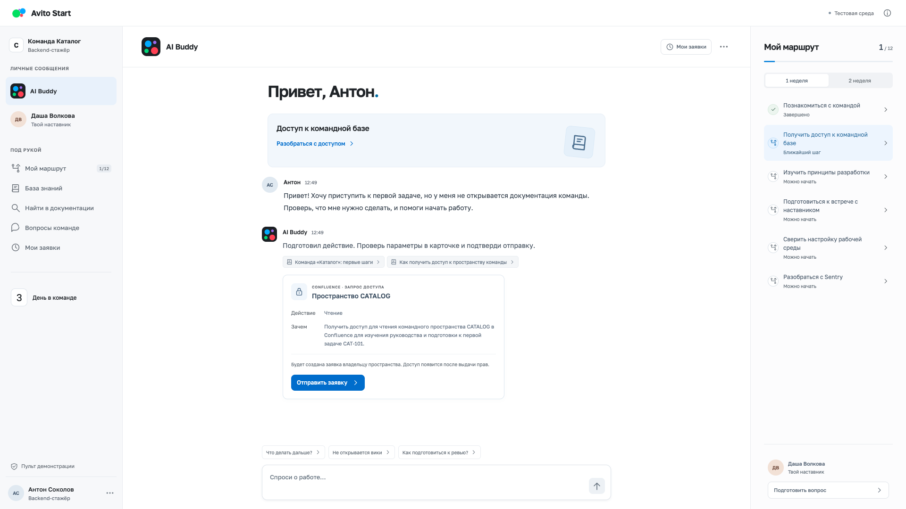

# AI Buddy в Avito Start

Avito Start — рабочая среда прототипа, AI Buddy — личный собеседник в ней.

AI Buddy помогает стажёрам разных направлений освоиться в команде: разобраться
с рабочим вопросом, найти нужный материал и понять следующий шаг. Ответы
опираются на доступные источники и контекст команды. Чек-лист задаёт маршрут
адаптации, но не ограничивает темы вопросов.

Прототип для кейса Авито на Hack&Change 2026. Демонстрационный набор охватывает
первые две недели на Backend-примере из кейса. Другие направления потребуют
своих материалов, маршрутов и проверки качества.



[Видео рабочего пути, 1 минута 2 секунды](docs/assets/demo.mp4) ·
[Презентация PDF](docs/assets/AI-Buddy.pdf) ·
[Редактируемые слайды](docs/assets/AI-Buddy.pptx) ·
[Комплект для проверки](docs/submission.md)

## Возможности прототипа

- Личный диалог: Qwen выбирает разрешённые инструменты, уточняет и готовит действия.
- Поиск BM25 + локальные embeddings с RRF; права проверяются до поиска.
- Маршрут адаптации с задачами, зависимостями и ближайшим доступным шагом.
- Запрос доступа и назначение первой задачи через имитацию корпоративного сервиса:
  проверка параметров, подтверждение, сохранённый результат и статус.
- Поиск свежих фрагментов официальной документации Go и Git по сети.
- Вопрос ответственному с проверкой перед отправкой и отдельным обсуждением.
  У наставника — запросы по стажёрам; у владельца вики — свои согласования.

Команды, профили и внутренние инструкции синтетические. Настоящие Mattermost,
Confluence и Jira не подключены; MCP-адаптер предстоит реализовать.

Стек: React, TypeScript, Go и PostgreSQL. Языковая модель — локальная Qwen3.5 4B
через Ollama. Проверен запуск на Linux CPU без API-ключа. Подключение реальных данных и сервисов описано в
[архитектуре](docs/architecture.md).

## Быстрый запуск

Нужны Git, Docker с Compose v2 и интернет для первой загрузки.
Открой терминал и выполни:

```sh
git clone https://github.com/Astarino/ai-buddy.git
cd ai-buddy
sh scripts/jury.sh --check
sh scripts/jury.sh --model
```

Открой [localhost:8090](http://localhost:8090) и выбери тестовый профиль.
Первый запуск загружает около 3,3 ГБ Qwen и 622 МБ EmbeddingGemma. Ollama ограничена 6 GiB памяти;
базе, приложению и сборке нужна дополнительная память. GPU и API-ключ не нужны.
Дождись завершения команды: сервисы загружают модели и проверяют готовность.
Выбери Антона и пройди [семь шагов демонстрации](docs/demo.md#повторить).
Имя среды — Avito Start, личный собеседник — AI Buddy.
Если порт занят: `BUDDY_PORT=8092 sh scripts/jury.sh --model`.
Остановить, сохранив данные: `docker compose -f compose.yaml -f compose.cpu.yaml down`.
Логи сбоя: `docker compose -f compose.yaml -f compose.cpu.yaml logs --tail=80`.

Для быстрого просмотра без модели: `sh scripts/jury.sh`. Такой режим явно
помечен в интерфейсе и использует фиксированные тестовые ответы.

[Нативный запуск и настройки](docs/run.md) ·
[Подключение настоящей Qwen](docs/model.md) ·
[Пошаговая демонстрация](docs/demo.md)

Главная демонстрация: недоступная документация → подтверждённая заявка →
согласование и отдельная выдача доступа → изучение руководства → назначение
первой задачи → ответ о ревью с источниками. Состояние сохраняется после обновления.

## Проверка

В подготовленной среде разработки с отдельной тестовой базой PostgreSQL:

```sh
make test
make coverage
make e2e
```

Последняя проверка: backend 85,62% строк, frontend 88,13%; 14 браузерных
проверок; 7/7 решений настоящей Qwen на CPU. Сравнение поиска — 26 вопросов,
без обнаруженных ACL-утечек. Это малые синтетические наборы, не пользовательский пилот.

Условия запуска, состав проверок и метод расчёта покрытия — в
[документации тестирования](docs/testing.md).

## Документация

- [Сценарии и требования SDD](specs/product.md)
- [Поведение агента](specs/agent.md) · [Агентный цикл](specs/agent-loop.md)
- [Поиск и его проверка](specs/retrieval.md) · [Сравнение поиска](reports/retrieval.json)
- [Права и защита данных](specs/security.md)
- [Контракты API](docs/api.md)
- [Корпоративный вход и интеграции](specs/integrations.md)
- [Запросы ответственным](specs/collaboration.md) · [Публичный поиск](specs/public-search.md)
- [Метрики и пилот](docs/metrics.md)
- [Речь для защиты и ответы жюри](docs/pitch.md)

Версии зависимостей закреплены в `go.mod`, `go.sum`, `web/package.json` и
`web/pnpm-lock.yaml`; проверенный CPU-вариант — в `model.cpu.lock.json`,
нативный вариант Mac — отдельно в `model.lock.json`.
