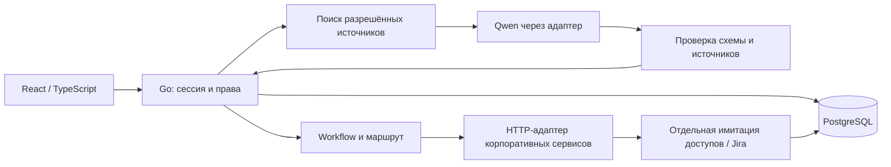

# Архитектура и внедрение

AI Buddy — помощник стажёров разных направлений в личном диалоге. Он помогает разобраться в рабочей ситуации, найти применимые знания, выполнить допустимое действие и определить следующий шаг. Содержание помощи зависит от направления, команды, этапа адаптации и прав человека.

Текущий прототип демонстрирует этот подход на Backend-примере из кейса. Его тестовый корпус и маршрут не описывают все возможные вопросы стажёров. Веб-оболочка проверяет способ работы без доступа к настоящему Mattermost. Полноценный корпоративный мессенджер или портал заявок не строится.

## Направления и вопросы стажёров

Чек-лист служит одним из источников задач и сроков. Пользователь может задать вопрос вне чек-листа: о рабочей задаче, непонятном процессе, инструменте, документе или о том, к кому обратиться. Основание для ответа — доступные применимые источники. Если их недостаточно, помощник уточняет ситуацию или готовит вопрос наставнику. Наличие вопроса не даёт модели новых прав и инструментов.

Для поддержки другого направления нужны его материалы, маршрут, контекст и при необходимости контракты действий. Например, у аналитика и Backend-стажёра могут различаться инструменты и первые задания при общих организационных шагах. Это требование к развитию продукта; поддержка и качество других направлений в текущем прототипе ещё не проверены.

## Где проходит ответственность

Go определяет роль, команду, доступные документы и допустимые действия. Модель получает только отобранные разрешённые документы, объясняет и уточняет. У неё нет сетевого доступа, SQL и инструментов изменения состояния. Выбор нескольких операций реализован ограниченным workflow; свободный текст не является подтверждением.

Неполный вопрос или конфликт источников может потребовать уточнения до модели.
Код проекта берётся из разрешённой инструкции, а явно названный публичный
документ можно показать дословной выдержкой (`kind=source`). Это серверные
ответы, не inference. Если модель сама признаёт нехватку сведений, ограниченная
проверка может перевести ответ в уточнение; она не доказывает истинность всех
утверждений. Сырые ответы и итог приложения разделены в модельных отчётах.

Модули:

- `internal/buddy`: роли, ACL, ранжирование, зависимости, ответы и безопасная история. Подготовка, подтверждение и восстановление действий собраны в `actions.go`; условия первой задачи проверяются одинаково при подготовке и исполнении.
- `internal/model`: Ollama, явно выбранный совместимый HTTP-провайдер и маркированная фикстура. Один слот генерации, схема, тайм-аут, отсутствие fallback.
- `internal/corporate`: реальная HTTP-граница, проверка контракта и отдельный сервис-имитация.
- `internal/publicdocs`: свежие снимки официальных документов Go/Git, локальное ранжирование; вопрос на внешние сайты не отправляется.
- `internal/storage`: PostgreSQL, транзакции и непрозрачные сессии.
- `internal/httpapi`: входные контракты, JSON, Origin, сессия, интерфейс и пульт оператора.
- `web/src`: явный API-клиент, диалог, маршрут, источники и карточки результатов. `App.tsx` управляет сессией и запросами, `navigation.tsx` показывает рабочие разделы и обзор ответственного, `conversation.tsx` отображает сообщения, источники и карточки действий. Представления получают обработчики событий и сами не вызывают API.

Это один прикладной backend с модулями. Имитация вынесена в отдельный процесс, чтобы проверять сетевые ошибки и потерянный ответ; она не является нашей заменой настоящих корпоративных систем.

## Состояние и конкурентность

Личный диалог, подготовленные действия, отметки и поисковые снимки хранятся небольшим JSONB-агрегатом на пользователя. Транзакция блокирует его строку на время изменения. Внешний сервис и модель вызываются вне этой блокировки; ответ добавляется отдельной транзакцией. Отдельный append-only журнал `buddy_audit` содержит инициатора, владельца, решение и корреляцию без текста вопроса. Конкурентные обновления проверяются на настоящем PostgreSQL.

Общие вопросы хранятся отдельно в `buddy_requests`, а не в личном чате. У каждой карточки свои участники, версия и обсуждение. Предварительный просмотр предшествует отправке. Наставник видит группы по стажёрам; владелец пространства получает карточку доступа. Текущий доверенный профиль и Authorizer проверяются перед чтением и ответом. При переназначении прежний получатель теряет доступ. Карточка согласования сначала сохраняет конкретное намерение, затем вызывает корпоративный HTTP API вне транзакции; повтор и неизвестный исход восстанавливаются по ключу операции. Роль наставника сама по себе не разрешает выдачу доступа. Это внутренний поток прототипа на синтетических профилях; настоящие DM и push-уведомления Mattermost не подключены.

Операции корпоративного сервиса имеют уникальный ключ идемпотентности и владельца. Отдельная транзакция сериализует создание по пользователю и запрещает два активных запроса одного ресурса. Операция сохраняется до сетевого ответа. После тайм-аута приложение сначала ищет её по прежнему ключу. Изменение параметров готовой карточки создаёт новую; прежняя получает `superseded` и не отправляется. Отклонённый запрос и отозванный доступ допускают новый запрос.

Содержимое закрытого пространства не кешируется в клиенте как постоянная база. Перед чтением и генерацией backend сверяет права с сервисом. Сохранённый ответ содержит серверные зависимости от всех переданных документов и истории с отпечатками содержимого и метаданных. Эти зависимости проверяются после генерации, при показе истории и повторе сообщения независимо от цитат модели. При отзыве, изменении источника или недоступности проверки ответ скрывается. Старые модельные ответы без таких зависимостей требуют нового вопроса. Отметка «прочитал» не подменяет права.

JSONB выбран для небольшого прототипа с ограничением истории в 200 сообщений. Для большого тиража историю и события следует вынести в отдельные таблицы с пагинацией и политикой хранения. Redis и векторная БД пока не нужны: небольшой корпус проверяется простым ранжированием с русскими префиксами. Embeddings добавляются после измеренных пропусков, а не как обязательная зависимость.

## Материалы и роли

Демонстрационный набор: две синтетические Backend-команды «Каталог» и «Доставка», шесть стажёров, два наставника и один владелец вики, 20 встроенных документов, 12 шагов. Это ограничение проверенного примера, а не аудитории AI Buddy. Публичные материалы — короткий пересказ чек-листа и Playbook с точным происхождением; командные инструкции помечены как тестовые. Закрытые заметки наставника присутствуют только как контроль ACL и никогда не предлагаются стажёру.

Маршрут сохраняет сроки исходного чек-листа: первая и вторая недели. Настройка конкретных корпоративных инструментов не выдумывается; при отсутствии команд предлагается уточнение. Задание в Jira — проектное продолжение адаптации, а не дословный пункт чек-листа.

## Реальная корпоративная среда

Эксперты в Q&A назвали Mattermost, Jira и Confluence. Доступа к их инфраструктуре у проекта нет. Код корпоративного режима описан ниже; его настройка и проверка в целевой среде остаются отдельным этапом. Адаптер Mattermost и промышленный индексатор ещё не подключены. Перенос inference требует новых evals и проверки ресурсов.

MCP в первой версии не заявляется. Существующий HTTP-контракт и Go-интерфейсы позволяют добавить его поверх того же доменного слоя. Это не требует расширения полномочий модели.

## Контракты реального подключения

Целевая схема: корпоративный канал → доверенная идентичность → серверные правила и подтверждения → адаптер API или MCP → корпоративная система. Данные проходят через коннектор источников с версиями и правами до поиска и передачи модели. API и MCP — способы взаимодействия; каждый подключаемый сервис требует отдельной настройки полномочий и проверки контракта.

`Corporate` содержит только чтение результатов и исполнение подтверждённых действий. Операторские события вынесены в отдельный `DemoOperator`; в корпоративном режиме они не регистрируются в API. Существующий HTTP-контракт — контракт адаптера проекта, а не готовый клиент API Jira/Confluence.

В `demo` используются встроенные синтетические профили и источники. Неизвестный Scope запрещён; право одного пространства не открывает другое. В `corporate` нужен доверенный файловый снимок каталога и отдельный `Authorizer`: проверяется конкретная система, тип ресурса, ID и действие. Ответ авторизации привязан к пользователю и ресурсу и имеет срок и версию политики. Разрешения не кешируются между запросами. Ошибка сервиса означает отказ. Наследование прав определяет корпоративная сторона.

Корпоративный вход — клиент существующего OIDC-провайдера с PKCE, state, nonce и проверкой ID token. Пара issuer/subject сопоставляется с каталогом; сессия привязана к доверенному профилю и сроку идентичности. Дополнительно проверяется актуальное право на аккаунт. Внутренний ID нельзя повторно назначить другому субъекту. Демо-вход, fixture и операторский токен в этом режиме не допускаются.

Журнал `buddy_audit` отделён от изменяемого состояния. Результат действия и запись о нём сохраняются транзакционно; ошибки HTTP, запуск обработки моделью и операторские переходы также фиксируются. Корпоративный runtime не выполняет миграции и должен работать ролью без UPDATE/DELETE журнала.

Внешний inference требует `public-only` и подтверждения конкретного вопроса для выбранного адреса и модели. Передаются только явно публичные источники с временными ID; история, команда и внутренние идентификаторы исключены. Сетевые клиенты не следуют редиректам. Эти механизмы проверены на локальной синтетике; реальная корпоративная среда не подключалась.

При подключении целевой инфраструктуры остаётся:

1. Зарегистрировать приложение в настоящем SSO, настроить доверенный каталог, TLS и корпоративный сервис авторизации. Утвердить сопоставление субъектов, команд и направлений.
2. Подключить обновление источников из Confluence или другого разрешённого хранилища. Файловый снимок загружается при запуске и не является работающим индексатором. Проверить обновления, удаления, наследование и отзыв на целевом источнике.
3. Реализовать адаптеры к согласованным API с минимальными полномочиями. Сервисная учётная запись не даёт стажёру её полный доступ. Собственный HTTP-контракт не означает готовую интеграцию с конкретной системой.
4. Сохранять точное подтверждение изменяющих действий, повторную проверку прав, защиту от дублирования и сверку результата с авторитетным сервисом. Если внешний API не поддерживает идемпотентность, отдельно реализовать восстановление после неизвестного результата.
5. Настроить хранилище и ротацию секретов, сетевую политику и TLS. HTTP разрешён только для явно локальных адресов; сервисы за пределами контура требуют HTTPS. Для OIDC задан отдельный список доверенных origins. Статический demo-токен не является корпоративной схемой.
6. Для MCP использовать доверенный набор серверов и инструментов, валидировать аргументы и результаты. При HTTP-авторизации проверять назначение токенов; токен MCP нельзя просто пересылать во внешний API вместо отдельной авторизации. MCP не заменяет прикладные права и согласование действий.
7. Утвердить провайдера, регион обработки, хранение, удаление и доступ к журналу; настроить отдельные роли миграций/runtime. Прикладная политика `public-only` не заменяет это решение. Внешнего fallback нет.
8. Проверить интеграцию в согласованной тестовой среде: чужие ресурсы, отзыв доступа, поддельные события, просроченные полномочия, инъекции в документах, тайм-ауты и повтор операции. Протокольный MCP-вызов проверить отдельно до заявления поддержки MCP.

Основание требований MCP: [официальная спецификация авторизации](https://modelcontextprotocol.io/specification/2026-07-28/basic/authorization/security-considerations), проверенная через Context7 11.11.2026. Список выше — требования к следующему этапу, а не отчёт о его выполнении. Замены URL и ключа недостаточно для реального внедрения.

## Эксплуатационные ограничения

Нативный inference на M4 не помещается в контейнер приложения и не передаётся браузеру. Контейнеры используют настраиваемый URL модели. Docker по умолчанию запускает явный fixture-режим для проверки приложения без GPU; настоящая Qwen и её проверка описаны отдельно. Внешний API требует явного выбора и разрешения передачи; автоматического перехода к нему нет.

Демо-вход и статические тестовые токены не являются production-аутентификацией. Прототип слушает loopback, Docker публикует только порт приложения на 127.0.0.1. Для внешнего доступа нужны TLS, реальные полномочия и согласованная эксплуатация. Чувствительные данные и финансовые операции находятся вне объёма.

## Публичные источники

`internal/publicdocs` получает три документа выбранного инструмента из официальных репозиториев Go или Git на `raw.githubusercontent.com`. Пути заданы в коде, редиректы и env-proxy отключены; DNS должен указывать на публичные адреса. На страницу отведено 8 секунд и 1 MiB, на поиск — 20 секунд. Вопрос ранжируется только внутри backend. Снимок с SHA-256, временем и исходной ссылкой хранится у пользователя и проходит проверку прав перед повторным чтением/ответом. На пользователя допускается 30 снимков поиска, обсуждение — до 100 сообщений. Полный интернет-поиск и выполнение shell-команд отсутствуют. Настоящий сетевой прогон воспроизводится через `RUN_PUBLIC_SEARCH_EVAL=true go test ./internal/publicdocs -run TestLiveOfficialDocumentation -count=1`.
