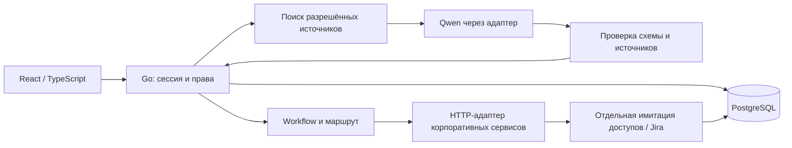

# Архитектура и внедрение

AI Buddy — помощник Backend-стажёра в личном диалоге. Он связывает инструкцию, организационное действие и следующий рабочий шаг. Веб-оболочка проверяет этот способ работы без доступа к настоящему Mattermost. Полноценный корпоративный мессенджер или портал заявок не строится.

## Где проходит ответственность

Go определяет роль, команду, доступные документы и допустимые действия. Модель получает только отобранные разрешённые документы, объясняет и уточняет. У неё нет сетевого доступа, SQL и инструментов изменения состояния. Выбор нескольких операций реализован ограниченным workflow; свободный текст не является подтверждением.

Модули:

- `internal/buddy`: роли, ACL, ранжирование, зависимости, подготовка и подтверждение, ответы и безопасная история.
- `internal/model`: Ollama, явно выбранный совместимый HTTP-провайдер и маркированная фикстура. Один слот генерации, схема, тайм-аут, отсутствие fallback.
- `internal/corporate`: реальная HTTP-граница, проверка контракта и отдельный сервис-имитация.
- `internal/storage`: PostgreSQL, транзакции и непрозрачные сессии.
- `internal/httpapi`: входные контракты, JSON, Origin, сессия, интерфейс и пульт оператора.
- `web/src`: явный API-клиент, диалог, маршрут, источники и карточки результатов.

Это один прикладной backend с модулями. Имитация вынесена в отдельный процесс, чтобы проверять сетевые ошибки и потерянный ответ; она не является нашей заменой настоящих корпоративных систем.

## Состояние и конкурентность

Личный диалог, подтверждения, отметки и аудит хранятся одним небольшим JSONB-агрегатом на пользователя. Транзакция блокирует только его строку на время изменения. Внешний сервис и модель вызываются вне этой блокировки; ответ добавляется отдельной транзакцией. Это сохраняет чужие изменения во время генерации. Конкурентные обновления проверяются на настоящем PostgreSQL.

Операции корпоративного сервиса имеют уникальный ключ идемпотентности и владельца. Отдельная транзакция сериализует создание по пользователю и запрещает два активных запроса одного ресурса. Операция сохраняется до сетевого ответа. После тайм-аута приложение сначала ищет её по прежнему ключу. Отклонённый запрос и отозванный доступ допускают новый запрос, но не повторное выполнение старого подтверждения с изменёнными параметрами.

Содержимое закрытого пространства не кешируется в клиенте как постоянная база. Перед чтением и генерацией backend сверяет права с сервисом. Если сервис недоступен, закрытые материалы временно скрыты. При отзыве скрываются и сохранённые ответы, ссылающиеся на этот источник. Отметка «прочитал» не подменяет права.

JSONB выбран для небольшого прототипа с ограничением истории в 200 сообщений. Для большого тиража историю и события следует вынести в отдельные таблицы с пагинацией и политикой хранения. Redis и векторная БД пока не нужны: небольшой корпус проверяется простым ранжированием с русскими префиксами. Embeddings добавляются после измеренных пропусков, а не как обязательная зависимость.

## Материалы и роли

Две синтетические Backend-команды: «Каталог» и «Доставка». Два профиля, 20 документов, 12 шагов. Публичные материалы — короткий пересказ чек-листа и Playbook с точным происхождением; командные инструкции помечены как тестовые. Закрытые заметки наставника присутствуют только как контроль ACL и никогда не предлагаются стажёру.

Маршрут сохраняет сроки исходного чек-листа: первая и вторая недели. Настройка конкретных корпоративных инструментов не выдумывается; при отсутствии команд предлагается уточнение. Задание в Jira — проектное продолжение адаптации, а не дословный пункт чек-листа.

## Реальная корпоративная среда

Эксперты в Q&A назвали Mattermost, Jira и Confluence. Доступа к их инфраструктуре у проекта нет. Следующий этап внедрения:

1. Заменить тестовый вход проверенной корпоративной идентичностью. Доверенный `user_id`, команда и роль приходят из корпоративного канала/SSO, а не текста чата.
2. Подключить индекс Confluence с происхождением, версиями и ACL. Удаление и отзыв прав должны распространяться на выдачу, историю и кеши.
3. Реализовать `Corporate` поверх согласованного внутреннего заявочного сервиса и Jira. Сохранить точное подтверждение, идемпотентность, владельца и разделение согласования/выдачи.
4. Подключить адаптер личного диалога Mattermost к тем же сценариям. Уведомления доставляются только владельцу с учётом ограничений канала.
5. Отключить пульт демонстрации и тестовый вход; корпоративные события принимать с проверкой подлинности и защиты от повторов.
6. Разместить inference в согласованном контуре и повторить evals, проверки прав, наблюдаемость и нагрузочные проверки.

MCP в первой версии не заявляется. Существующий HTTP-контракт и Go-интерфейсы позволяют добавить его поверх того же доменного слоя. Это не требует расширения полномочий модели.

## Эксплуатационные ограничения

Нативный inference на M4 не помещается в контейнер приложения и не передаётся браузеру. Контейнеры используют настраиваемый URL модели. Docker по умолчанию запускает явный fixture-режим для проверки приложения без GPU; настоящая Qwen и её проверка описаны отдельно. Внешний API требует явного выбора и разрешения передачи; автоматического перехода к нему нет.

Демо-вход и статические тестовые токены не являются production-аутентификацией. Прототип слушает loopback, Docker публикует только порт приложения на 127.0.0.1. Для внешнего доступа нужны TLS, реальные полномочия и согласованная эксплуатация. Чувствительные данные и финансовые операции находятся вне объёма.
